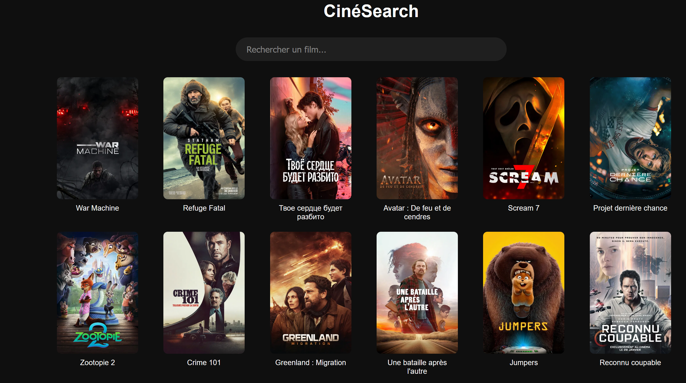
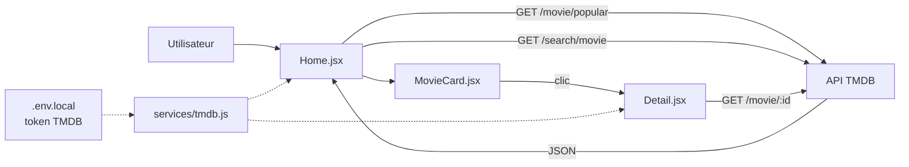
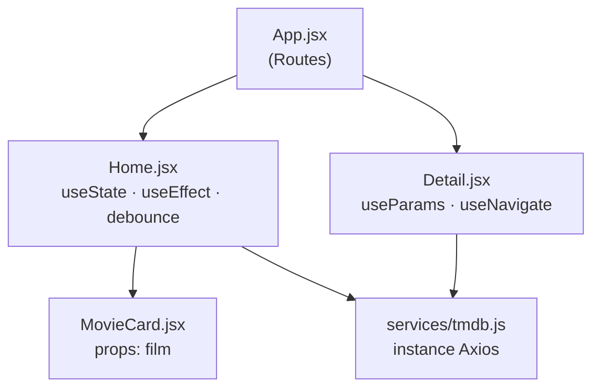
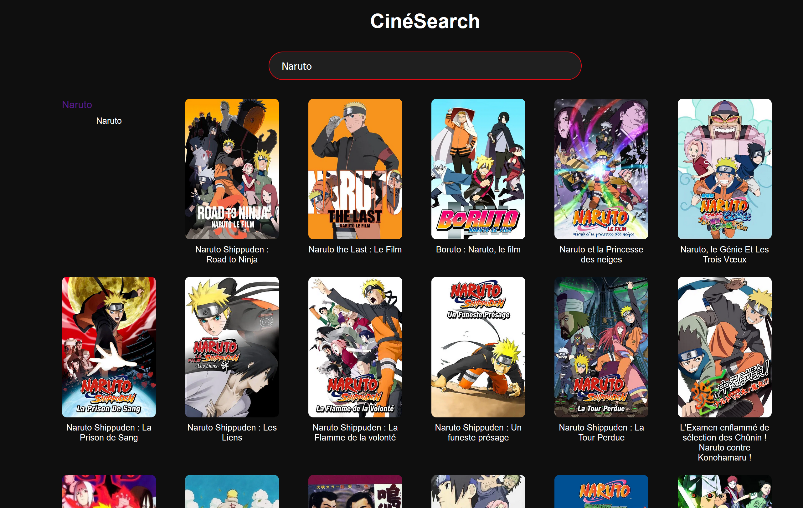
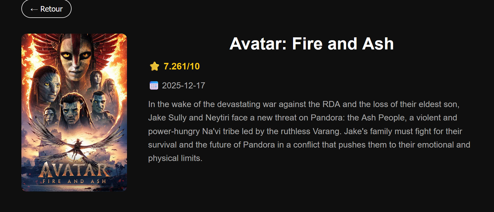
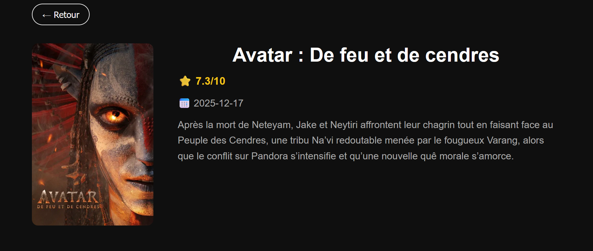

# CinéSearch


Application web de recherche et d'exploration de films construite avec React et l'API TMDB. Elle affiche les films populaires, permet une recherche dynamique avec debounce, et propose une page de détail pour chaque film — projet personnel réalisé pour pratiquer React et la consommation d'API REST.



---

## Architecture



| Composant | Rôle |
|---|---|
| `Home.jsx` | Page d'accueil, gère les appels API et l'état |
| `MovieCard.jsx` | Composant carte, reçoit un film via props |
| `Detail.jsx` | Page de détail, appelle l'API avec l'id de l'URL |
| `services/tmdb.js` | Instance Axios préconfigurée (baseURL + token + langue) |
| API TMDB | Source de données films |

---

## Stack technique

| Rôle | Outil |
|---|---|
| Framework UI | React 19 |
| Build tool | Vite 8 |
| Navigation | React Router 7 |
| Requêtes HTTP | Axios |
| Données | API TMDB (authentification par jeton v4) |
| Styles | CSS vanilla |

---

## Architecture des composants



---

## Fonctionnalités

- Affichage des 20 films populaires au chargement
- Recherche dynamique avec debounce 500 ms (une seule requête par saisie)
- État de chargement affiché pendant les requêtes
- Page de détail : affiche, synopsis, note arrondie à 1 décimale, date de sortie
- Données et descriptions en français (`language=fr-FR`)
- Jeton d'accès stocké en variable d'environnement, jamais dans le code versionné
- Navigation SPA sans rechargement de page

---

## Captures d'écran

| Accueil | Recherche « Naruto » |
|---|---|
|  |  |

| Fiche film — première version | Fiche film — version actuelle |
|---|---|
|  |  |

La première version affichait le titre et le synopsis en anglais avec une note brute (`7.261`). La version actuelle passe `language=fr-FR` dans l'instance Axios et arrondit la note (`7.3`).

---

## Exemple de résultat

Requête effectuée par l'app :
```
GET https://api.themoviedb.org/3/movie/popular?language=fr-FR
Authorization: Bearer <token>
```

Extrait de la réponse :
```json
{
  "results": [
    {
      "id": 550,
      "title": "Fight Club",
      "vote_average": 8.4,
      "poster_path": "/abc123.jpg",
      "overview": "Un employé de bureau insomniaque..."
    }
  ],
  "total_results": 1114712
}
```

---

## Choix techniques

- **Vite plutôt que Create React App** : CRA n'est plus maintenu activement. Vite démarre en moins d'une seconde et est utilisé sur les projets récents.
- **Axios plutôt que fetch natif** : permet de centraliser la configuration (baseURL, header `Authorization`, langue) dans une instance réutilisable dans `tmdb.js`. Sans ça, chaque appel répète la même configuration.
- **Debounce 500 ms sur la recherche** : sans debounce, taper "Batman" envoie 6 requêtes API au lieu d'une. Le `clearTimeout` annule le timer précédent à chaque frappe.
- **Jeton v4 dans l'en-tête `Authorization`** : c'est le mode d'authentification recommandé par TMDB, configuré une seule fois dans l'instance Axios. Attention : ce n'est pas une protection du secret. Comme toute variable `VITE_`, le jeton est intégré au code envoyé au navigateur et reste visible dans l'onglet réseau. Le protéger demanderait un petit backend qui appelle TMDB à la place du navigateur.
- **`.env.local` pour la configuration** : le jeton ne figure jamais dans le code versionné. Le fichier est automatiquement ignoré par Git via `*.local` dans `.gitignore`.
- **Composant `MovieCard` isolé** : sépare la logique de récupération (Home) de l'affichage d'une carte. MovieCard ne sait pas d'où viennent les données, il reçoit un objet `film` via props.
- **React Router pour la navigation** : permet des URLs propres (`/film/:id`) et une navigation sans rechargement, contrairement à une gestion manuelle de l'état.

---

## Lancer le projet

**Prérequis**
- Node.js 20.19+ ou 22.12+ (requis par Vite 8)
- Un jeton d'accès TMDB v4 (gratuit) : [themoviedb.org/settings/api](https://www.themoviedb.org/settings/api)

```bash
# 1. Cloner le dépôt
git clone https://github.com/SKGE93/cine-search.git
cd cine-search

# 2. Installer les dépendances
npm install

# 3. Créer le fichier de configuration
cp env.example .env.local
# Renseigner VITE_TMDB_API_KEY dans .env.local avec le jeton d'accès v4

# 4. Lancer le serveur de développement
npm run dev
# → http://localhost:5173
```

**env.example**
```
VITE_TMDB_API_KEY=Met_ton_Token_ici
```

---

## Tests et qualité

Pas de tests automatisés sur ce projet.

```bash
# Linter ESLint
npm run lint

# Build de production
npm run build
```

---

## Structure du dépôt

```
cine-search/
├── public/
├── screenshots/               # Captures utilisées dans ce README
├── src/
│   ├── components/
│   │   └── MovieCard.jsx      # Composant carte film réutilisable
│   ├── pages/
│   │   ├── Home.jsx           # Page d'accueil avec recherche et grille
│   │   └── Detail.jsx         # Page de détail d'un film
│   ├── services/
│   │   └── tmdb.js            # Instance Axios TMDB préconfigurée
│   ├── App.jsx                # Routeur principal (Routes/Route)
│   ├── App.css                # Styles layout et grille
│   ├── index.css              # Reset CSS global
│   └── main.jsx               # Point d'entrée React + BrowserRouter
├── env.example                # Variables d'environnement à configurer
├── .gitignore                 # Exclut .env.local et node_modules
└── package.json
```

---

## Limites et pistes d'amélioration

- Pas de pagination : seuls les 20 premiers résultats sont affichés
- Pas de message si la recherche ne retourne rien ou si l'API échoue : les appels n'ont pas de gestion d'erreur
- Les films sans affiche s'affichent sans image : l'image de remplacement dépend d'un service externe qui ne répond pas (visible sur la recherche « Naruto »)
- Le jeton TMDB est visible côté navigateur : un backend proxy serait nécessaire pour le garder secret
- Les favoris ne sont pas implémentés (localStorage prévu mais non réalisé)
- Pas de filtre par genre
- Pas de tests automatisés

---

## Auteur

**Séraphin Eyala** — étudiant en MSc Data Engineering & Cloud Computing à aivancity, titulaire d'un BUT Informatique spécialité développement d'applications.

[LinkedIn](https://www.linkedin.com/in/seraphin-eyala-68557b279/) · [Portfolio](https://skge93.github.io/Portfolio/) · [GitHub](https://github.com/SKGE93)
